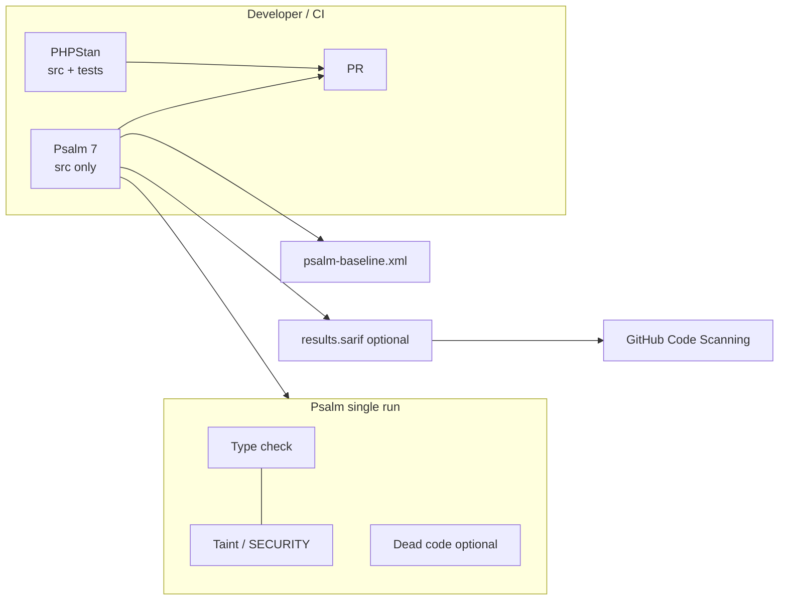

# Psalm 7 — implementation plan

**Audience:** implementation agent on stacked branches.  
**Gates (per [development skill](file://~/.cursor/skills/development/SKILL.md)):** `composer test` (≥95% line coverage on `src/`), `composer mutate` (≥80% MSI / covered MSI), `composer cs`, **`composer stan`** (unchanged). Add **`composer psalm`** once M2 lands; optional meta-script `composer analyse` runs stan + psalm.

**Security context:** Static taint finds *possible* source→sink paths. It will not prove CSRF, session fixation, IDOR, or authZ gaps. Cross-check high-signal Psalm hits against [security-review-owasp-cisa.md](../security-review-owasp-cisa.md).

---

## Architecture



| Tool | Scope (initial) | Role |
|------|-----------------|------|
| PHPStan ^1.4 | `src`, `tests` (today: no `phpstan.neon` in repo; defaults) | Primary **type** gate; keep unless a later milestone proves redundant |
| Psalm 7 | `src/` only | **Types + taint**; `SECURITY` header in console; SARIF for Code Scanning |

**Why dual-run:** PHPStan is already in `composer.json` and milestone history; Psalm 7’s value here is **default-on taint** and PSR-7 stubs ([Psalm 7 announcement](https://psalm.dev/articles/psalm-7), [security analysis docs](https://psalm.dev/docs/security_analysis/)). Migrating off PHPStan is **not** planned unless maintenance cost forces it after M5.

**Composer scripts (target after M2):**

| Script | Command intent |
|--------|----------------|
| `psalm` | `psalm --no-cache` (or `--threads=max`) |
| `psalm:ci` | `psalm --output-format=github` (PR annotations) |
| `psalm:security` | `psalm --report=build/psalm-security.sarif` (gitignore `build/`) |
| `analyse` | `composer stan && composer psalm` |

**Dependencies (M1, not on planning branch):**

- `vimeo/psalm`: `^7.0`
- `psalm/plugin-phpunit`: `^1.0` (PHPUnit 12; see [upgrading to Psalm 7](https://psalm.dev/docs/running_psalm/upgrading_to_psalm_7/))
- No custom Psalm plugin package unless M4 needs one; prefer **project stubs** under `stubs/` loaded from `psalm.xml`

---

## Configuration (`psalm.xml` sketch — M2)

- **Project root:** repository root; PSR-4 `Amtgard\IdP\` → `src/`
- **`projectFiles`:** `<directory name="src" />` only (mirror *initial* Psalm scope; PHPStan continues to include `tests/`)
- **`runTaintAnalysis`:** `true` (default in v7; set explicitly for clarity)
- **`loadLibraryStubs`:** `true` (PSR-7, Guzzle, Monolog, etc. — reduces custom stub work)
- **`errorLevel`:** start at `1` or `4` after first scan; tighten in later milestones only with baseline delta review
- **`findUnusedBaselineEntry`:** `true` after baseline exists (Psalm 7 behavior)
- **Plugins:** enable `psalm/plugin-phpunit` for test-aware analysis if we later widen scope to `tests/`; keep disabled for M2–M4 while scope is `src/` only
- **Autoload files:** include `src/register_orn_definitions.php` if Psalm misses symbols (match PHPUnit bootstrap)

**PHPUnit / Infection:** Psalm does not replace coverage or mutation gates. No requirement for new tests solely to satisfy Psalm unless a milestone fixes real taint (preferred) or documents a false positive suppression.

---

## Baseline and suppressions (M3+)

First full run on `src/` will report hundreds of type issues (strict app, no prior Psalm) **plus** SECURITY taint paths. Strategy:

1. **Generate baselines on M3** after M2 config is stable:
   - `vendor/bin/psalm --set-baseline=psalm-baseline.xml` (types + security in one file initially)
   - Optional split if noise is high: `--set-baseline=psalm-taint-baseline.xml` with `--use-baseline=psalm-taint-baseline.xml` documented in `psalm.xml` for taint-only suppressions ([docs](https://psalm.dev/docs/security_analysis/))
2. **Prefer fixing over baselining** for:
   - New code in the same milestone
   - `RedirectValidator` / `ScriptAlertResponse` flows (see M4)
   - Obvious `TaintedHtml` in controllers returning raw strings
3. **Inline suppressions** only with comment + ticket reference:
   - `@psalm-suppress TaintedHtml` — last resort
   - `@psalm-taint-skip` — sparingly for known-safe test doubles (should not appear in `src/` production paths)
4. **Maintenance:** `composer psalm -- --update-baseline` removes **fixed** entries only; new issues require `--set-baseline` refresh or code fix ([upgrade guide](https://psalm.dev/docs/running_psalm/upgrading_to_psalm_7/))
5. **Purity suggestions:** leave `findUnusedCode` / `MissingPureAnnotation` **off** until baseline is flat; optional M6+ milestone can enable `extraFiles` + `--alter` for `@psalm-pure` on hot paths to cut false positives (called out in Psalm 7 upgrade notes)

**Templates:** `templates/*.twig` are not in `projectFiles`. Twig **render call sites** in `src/` are the HTML sinks Psalm sees (`Twig\Environment::render`). Auto-escaping in Twig reduces but does not eliminate false positives when tainted arrays are passed as context.

---

## Slim / PSR-7 / app taint model (M4)

Psalm 7 loads **PSR-7 taint stubs** when `loadLibraryStubs` is on. The IDP uses **Slim** + **slim/psr7**; controllers read:

- `$request->getQueryParams()`
- `$request->getParsedBody()`
- `$request->getServerParams()` / cookies via middleware

**Verify on M4** that stubs cover Slim’s concrete request class; if gaps remain, add `stubs/psr-http-message.php` (or patch annotations on a single wrapper) using patterns from [psalm-plugin-laravel taint docs](https://github.com/psalm/psalm-plugin-laravel/blob/master/docs/contributing/taint-analysis.md):

```php
/**
 * @psalm-taint-source input
 */
public function getQueryParams(): array {}
```

**Application sanitizers** (annotate, do not baseline away):

| Symbol | Taint role | Notes |
|--------|------------|--------|
| `RedirectValidator::isSafe` | conditional guard | Return type `bool`; use `@psalm-assert-if-true string $url` if needed |
| `RedirectValidator::sanitize` / `sanitizeOrNull` | **escape** open-redirect taint | Pair `@psalm-taint-escape url` with `@psalm-flow ($url) -> return` per Psalm rules |
| `ScriptAlertResponse::alertAndRedirect` | mixed | Uses `json_encode` for JS string; **redirect URL** must flow through `RedirectValidator` before entry; message param may still be `TaintedHtml` if echoed unsafely — review OAuth error paths |
| `json_encode`, `urlencode` | partial escapes | Psalm tracks kinds; do not assume they clear all `html` taint without stubs |

**Sinks to expect in this codebase:**

- `Twig\Environment::render` — `TaintedHtml` when context values are tainted
- `Psr\Http\Message\ResponseInterface::withHeader('Location', …)` — open redirect / URL component taint ([`TaintedUrlPath`](https://psalm.dev/articles/psalm-7))
- `BaseAuthController` and auth flows — **JWT in query string** is a **design** issue (see security review); Psalm may flag URL taint; fixing behavior is separate from taint annotations
- SQL — mostly parameterized via AARO repositories; watch raw `query()` and dynamic fragments
- `unserialize` — session/Redis paths; Psalm may not model PHP object injection fully; keep manual review

**Optional thin wrapper (CONSIDER):** `IdpRequestInput` service that reads query/body once and documents taint policy — only if M4 suppressions explode; default is annotations on existing controllers.

---

## PHPStan coexistence

| Concern | Approach |
|---------|----------|
| Duplicate type errors | Accept some overlap; Psalm baseline handles Psalm-specific type IDs. PHPStan remains authoritative for `composer stan` until explicitly changed |
| Conflicting `@param` types | Prefer PHPStan-friendly phpdoc; Psalm generally agrees on PSR-4 strict project |
| `tests/` | PHPStan only until a dedicated milestone widens Psalm to `tests/` with `issueHandlers` / test baseline |
| CI time | Run jobs in parallel: `stan` job + `psalm` job (see below) |

**No** `phpstan-psalm-plugin` cross-suppression in M1–M5 unless dual noise is unbearable.

---

## CI — GitHub Actions (documented M6; wiring optional)

The repo has **no** `.github/workflows` today. Recommended path:

1. Locally after M2: `vendor/bin/psalm --init-ci` → template `.github/workflows/psalm.yml` ([PR #11748](https://github.com/vimeo/psalm/pull/11748))
2. Pin image `ghcr.io/psalm/psalm` to lockfile Psalm version ([upgrade guide](https://psalm.dev/docs/running_psalm/upgrading_to_psalm_7/))
3. **Security / SARIF upload** (parallel job or step):
   ```yaml
   - run: vendor/bin/psalm --report=results.sarif
   - uses: github/codeql-action/upload-sarif@v3
     with:
       sarif_file: results.sarif
   ```
   See [Security Analysis — GitHub Code Scanning](https://psalm.dev/docs/security_analysis/)
4. **Composer install** must match app: PHP **8.4**, `ext-redis` if Psalm loads bootstrap that touches container (otherwise use `--no-progress` analyse-only without booting app)
5. **Gates in CI:** at minimum `composer psalm`; full release stack still `test` + `mutate` + `stan` + `psalm`

Milestone M6 can commit workflow + `composer audit` (per security review) or stop at `agent/cursor/psalm-7/ci-example.yml` if team defers repo workflow.

---

## Suggested file layout (post-M2)

```
psalm.xml
psalm-baseline.xml          # committed
stubs/                      # M4: Twig, app-specific escapes
build/                      # gitignored — SARIF, caches
agent/cursor/psalm-7/       # this plan (M0)
```

---

## Milestone log

Append completion notes to [milestones.md](./milestones.md): branch, commit, coverage, Infection MSI, Psalm issue counts (ERROR vs SECURITY), baseline line count delta.
